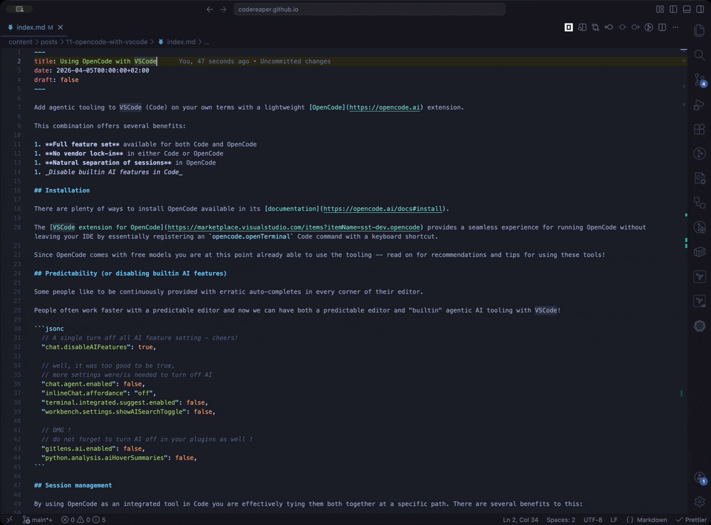
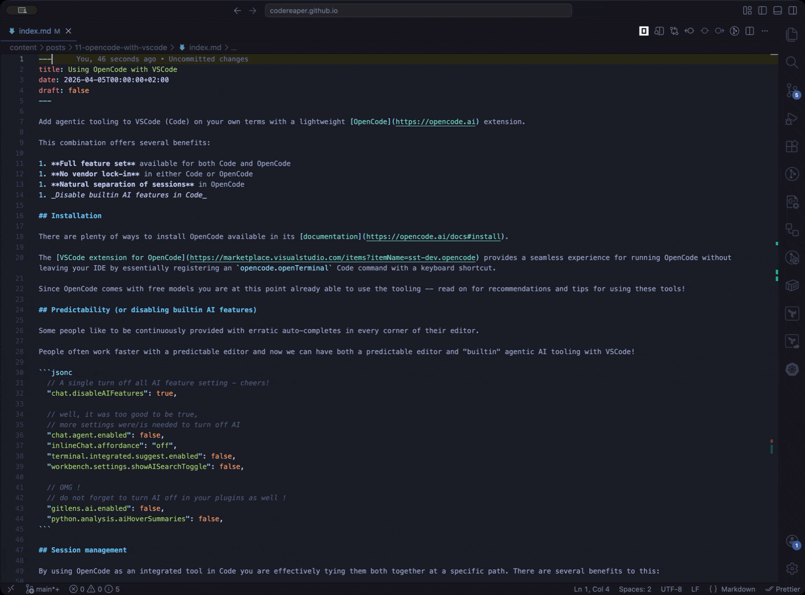
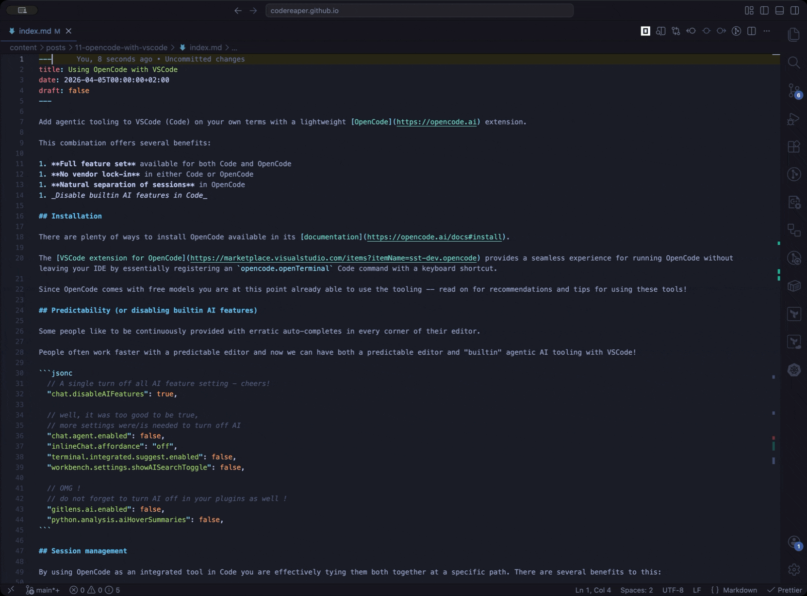
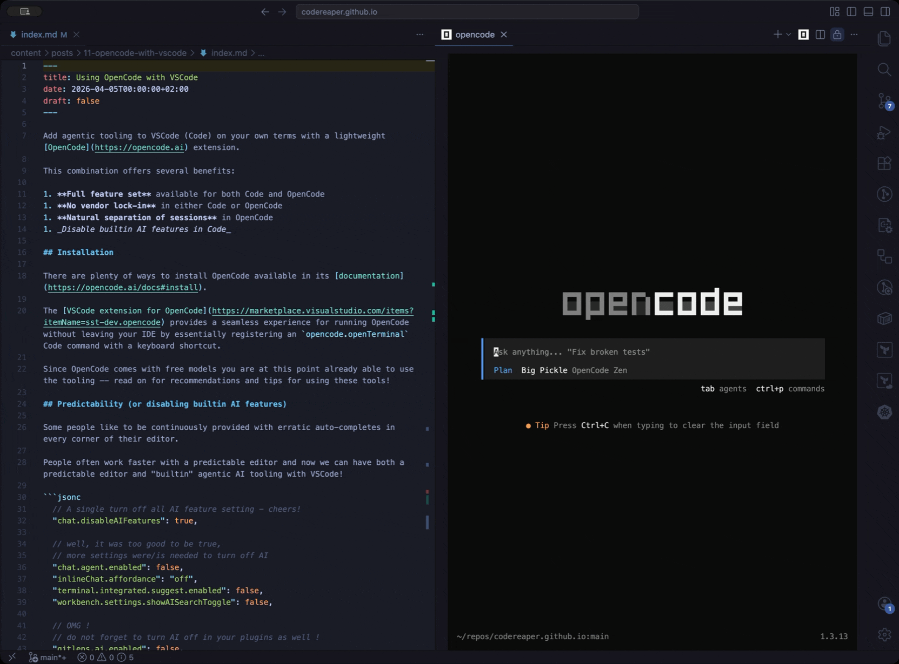

Add agentic tooling to VSCode (Code) on your own terms with a lightweight [OpenCode](https://opencode.ai) extension.

This combination offers several benefits:

1. **Full feature set** available for both Code and OpenCode
1. **No vendor lock-in** in either Code or OpenCode
1. **Natural separation of sessions** in OpenCode
1. _Disable builtin AI features in Code_

## Installation

There are plenty of ways to install OpenCode available in its [documentation](https://opencode.ai/docs#install).

The [extension](https://marketplace.visualstudio.com/items?itemName=sst-dev.opencode) for Code provides a seamless experience for running OpenCode without leaving your IDE by essentially registering an `opencode.openTerminal` Code command with a keyboard shortcut.

Since OpenCode comes with free models you are at this point already able to use the tooling -- read on for recommendations and tips for using these tools!

## Predictability (or disabling builtin AI features)

Some people like to be continuously provided with erratic auto-completes in every corner of their editor.

People often work faster with a predictable editor and now we can have both a predictable editor and "builtin" agentic AI tooling with VSCode!

```jsonc
  // A single turn off all AI feature setting - cheers!
  "chat.disableAIFeatures": true,

  // well, it was too good to be true,
  // more settings were/is needed to turn off AI
  "chat.agent.enabled": false,
  "inlineChat.affordance": "off",
  "terminal.integrated.suggest.enabled": false,
  "workbench.settings.showAISearchToggle": false,

  // OMG !
  // do not forget to turn AI off in your plugins as well !
  "gitlens.ai.enabled": false,
  "python.analysis.aiHoverSummaries": false,
```

## Session management

By using OpenCode as an integrated tool in Code you are effectively tying them both together at a specific path. There are several benefits to this:

1. **Sessions are organized per project** - OpenCode automatically manages sessions based on your current directory.
2. **Code and OpenCode work on the same directory** - Your editor always shows the same files as OpenCode can see and work on.
3. **Easy project switching** - There is no mental load of which OpenCode instance belongs to which Code instance.

This does rely on Code opening your project at its root directory, as you should be doing anyway.

## Security

There are a number of things to be aware of security-wise that can be configured in the `opencode.jsonc` file.

There are two ways of sharing a conversation between you and your agent with a third party:

1. `export` - which allows you to save or copy everything as markdown
2. `share` - which publishes everything at a unique OpenCode controlled URL

We should disable sharing:

```jsonc
  "share": "disabled",
```

The big one for security is permissions. We can configure all tool calls with `ask`, `allow` or `deny`.
Obviously the safest option is `ask`, but realistically you will need to find out which tool calls to `allow`.

A default permissive set of permissions could look like this:

```jsonc
  "permission": { // set permissions for all agents
    "*": "ask",
    "bash": {
      "*": "ask",
    },
    "codesearch": "allow",
    "edit": "deny",
    "glob": "allow",
    "grep": "allow",
    "list": "allow",
    "read": {
      "*": "allow",
      "*.env": "deny",
      "*.env.*": "deny",
      "*.env.example": "allow",
    },
    "task": "allow",
    "todoread": "allow",
    "todowrite": "allow",
    "skill": "allow",
    "webfetch": "allow",
    "websearch": "allow",
  },
  "agent": {
    "build": {
      "permission": {
        "edit": "allow", // allow edit mode to use edit tool because we deny it in the permissions below
      },
    },
  },
```

The problematic permission is `bash` which you _really_ need to configure and **not** just set to `allow`!

It does not take too long to build up a good whitelist of permissions by simply adding them as you encounter them in your daily use.
Below is a part of my permission set.

```jsonc
    "bash": {
      "*": "ask", // always keep ask or deny as the fallback
      "brew list *": "allow",
      "cat *": "allow",
      "cd *": "allow",
      "curl *": "ask",
      "echo *": "allow",
      "find *": "allow",
      "find * --exec *": "deny",
      // ...
      "which *": "allow",
      "wget *": "deny",
    },
```

View my current permissions in my [`opencode.json`](https://github.com/CodeReaper/dotfiles/blob/main/.config/opencode/opencode.jsonc).

## Keybindings

It is quite easy to configure a mouse-free experience using mostly the default keybindings in Code.

We need the following changes:

1. Replace `cmd+j` to toggle terminal panel
2. Add `cmd+k cmd+o` to launch OpenCode
3. Add `cmd+l cmd+k` to toggle editor group sizes

... in `keybindings.json`:

```jsonc
  {
    "command": "workbench.action.terminal.toggleTerminal",
    "key": "cmd+j",
    "when": "terminal.active"
  },
  {
    "command": "-workbench.action.togglePanel",
    "key": "cmd+j"
  },
  {
    "command": "workbench.action.toggleEditorWidths",
    "key": "cmd+l cmd+k"
  },
  {
    "command": "opencode.openTerminal",
    "key": "cmd+k cmd+o",
    "when": "!terminalFocus"
  }
```

### Using your Keybindings

You can move focus between the 3 editor groups with `cmd+1`, `cmd+2`, and `cmd+3`.

The editor groups can be closed by closing every tab in them with `cmd+w`.

You can use `cmd+j` to jump to the terminal panel.



The OpenCode command will open in an editor group with `cmd+k cmd+o`.

Note the OpenCode tab has a confirmation tab to close, so it needs `cmd+w enter` to close.



The `cmd+l cmd+k` shortcut can be used to toggle the maximum width of an editor group.



You can add a file reference or selected lines in a file as a reference to an active OpenCode instance with `cmd+option+k`.


